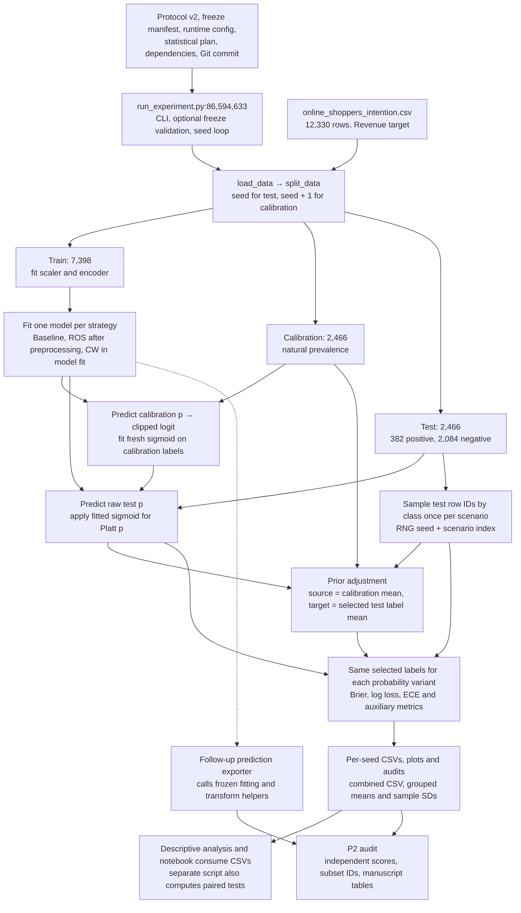

# Version 11 scientific code audit

The saved results reproduce the manuscript's main numerical claims and Tables 1–4. The implementation does not fully match the Platt method in §2.4. The PDF specifies clipping at `1e-15` and describes minimizing binary log loss. The implementation clips at `1e-12` and fits an L2-penalized loss. The sign difference between the two sigmoid formulas is an equivalent parameter convention.

The audit used the local [version 11 manuscript](../Imbalance%20Handling%20and%20Probability%20Calibration%20under%20Class%20Prior%20Shift%20in%20Online%20Purchase%20Prediction%20ver%2011.pdf) as the specification. Page numbers refer to the 13-page PDF. Its SHA-256 is `2ec63d687e650b1a9b46c9fb33c90030c156a92aef385ff9739a87b56b7fee6c`. Equations on pp. 3–5 and tables and figures on pp. 6–9 were inspected in rendered pages. The result manifest identifies source commit `2f448140cbdf5a593d1d182f26ef955d83cc717b`. The current experiment, gate, and statistical-analysis scripts have no Git diff against that commit. The archived observation-level predictions are a subsequent export from the frozen source, as documented by `scientific_validation_followup/export_predictions.py:1–5,45–103`.

## Pipeline and artifact dependencies



`run_experiment.py:364–513` runs a repetition and `run_experiment.py:516–528,594–641` aggregates and exports. `protocol_validation.py:85–125` checks the freeze before a confirmatory run writes output. The descriptive reporting consumers include `scientific_results_depth_analysis/analyze_results.py` and `notebooks/build_notebook.py:23–87,123–199`. The latter builds the reporting notebook, and `notebooks/execute_notebook.py` executes it. `audit_and_paired_analysis.py:201–265,268–340` is a separate consumer for statistical tables, including paired Wilcoxon and Holm calculations. The confirmatory run archive has 30 per-seed directories, 1,080 combined rows, 90 training metadata rows, 90 scenario audits, and an aggregate with 36 conditions. The CLI default is one seed (42). The archived 30-seed command is explicit in `outputs_confirmatory_30_seeds/execution_logs/run.txt:1–14`.

## Formula and implementation matrix

One row is one audit check. Severity records the potential impact if the check reveals a problem. PASS rows require no corrective action or rerun. The findings below give the impact and disposition for each other row.

| Component | Manuscript specification | Code implementation | Evidence | Status | Severity |
|---|---|---|---|---|---|
| D01 Dataset and labels | §2.2 and Table 1. 12,330 rows, 17 predictors, 1,908 positives, no missing data | Reads CSV, validates binary Revenue, and removes Revenue from predictors | `run_experiment.py:126–138`; `test_data_leakage.py::test_dataset_and_all_stratified_partitions` | PASS | HIGH |
| D02 Repetitions and stratification | §2.1 and Table 1. Seeds 42–71, two stratified stages, 60/20/20 | Uses `seed` for test and `seed+1` for calibration. Every split has 7,398/2,466/2,466 rows | `run_experiment.py:141–154,615–618`; `confirmatory_protocol_v2.json:7–13`; all 30 live splits | PASS | HIGH |
| D03 Partition isolation | §2.2. Mutually exclusive row indices | Checks pairwise disjointness and full dataset coverage | `run_experiment.py:366–373`; all 30 live splits and labels matched to dataset IDs | PASS | HIGH |
| D04 Preprocessing and fit scope | §2.2. Train-only scaling and encoding, then reuse | Standardizes numeric and Boolean columns, including integer-coded categories. One-hot encodes Month and VisitorType with unknown categories ignored | `run_experiment.py:157–172,218–219,417–421`; live seed-42 fit spy verified train values and scaler means | PASS | HIGH |
| D05 Baseline and base objective | §2.3. Original training distribution and conceptual L2 logistic objective, with LIBLINEAR details | `liblinear`, L2, `C=1`, `max_iter=2000`, per-split random state. Baseline uses original rows and unit weights | `run_experiment.py:38–43,170–200`; all 90 fit metadata records and fit spy | PASS | HIGH |
| D06 ROS | §2.3. Duplicate minority observations only during training | `RandomOverSampler` runs after train-only preprocessing. ROS reaches 6,253 or 6,254 observations per class | `run_experiment.py:170–179,191–209`; fit spy and training metadata | PASS | HIGH |
| D07 Class weighting | §2.3. Balanced inverse-frequency weights during model fitting | Uses `class_weight="balanced"` only for CW. Weights are `N/(2 n_c)`; training row counts are preserved | `run_experiment.py:174–200`; fit spy and all 90 metadata records | PASS | HIGH |
| D08 Model and calibration data flow | §§2.2, 2.4. Holdout labels stay outside base fit; test rows stay outside calibrator fit | Fits classifier on training only. Fits a new calibrator with calibration probabilities and labels inside each strategy and repetition | `run_experiment.py:364–368,416–439`; live spy intercepted base and calibration fits | PASS | HIGH |
| D09 Duplicate feature vectors | §§2.2, 3.5. Retained exact matches can span row-disjoint partitions | No deduplication or group split. 76 groups, 201 records, 125 beyond the first, all negative | `run_experiment.py:126–154,369–373`; all 30 duplicate tests and exclusion CSV comparison | WARNING | MEDIUM |
| D10 Temporal feature availability | §3.5. Availability at a real-time decision point is uncertain | All 17 predictors enter the model. The local CSV contains session summaries without event-time lineage | `run_experiment.py:126–138,157–172`; `online_shoppers_intention.csv:1` | NOT VERIFIED | MEDIUM |
| P01 Platt input and sign | §2.4. `f=logit(p)`, `1/(1+exp(A f+B))` | Passes logits to a logistic regression, then takes class-1 probability `sigmoid(a f+b)`. Set `A=-a, B=-b` for the PDF notation | `run_experiment.py:222–236`; fit/apply spy and rendered p. 4 | PASS | HIGH |
| P02 Platt clipping threshold | §2.4. `epsilon=1e-15` before logit | Uses `EPS=1e-12` on fit and apply, with separate clipping for the numerator and complement | `run_experiment.py:36,222–236`; boundary test and archived raw probabilities | FAIL | MEDIUM |
| P03 Platt objective | §2.4. Estimates A and B by minimizing binary logarithmic loss, with no penalty specified | Minimizes summed binary log loss plus `a²/(2C)` with `C=1`. The intercept is unpenalized for LBFGS | `run_experiment.py:44–50,222–231`; independent penalized and unpenalized score equations | FAIL | MEDIUM |
| P04 Separate probability variants | §§2.4–2.5 and Table 2. Raw and Platt predictions are distinct | Retains both arrays in memory and exports separate metric rows. A later exporter persists distinct per-observation columns | `run_experiment.py:437–451,471–505`; `scientific_validation_followup/export_predictions.py:72–92` | PASS | LOW |
| B01 Source prior | §2.4. Natural calibration prevalence | Uses `y_cal.mean()` across the three strategies, including ROS and CW. 381/2,466 in 14 splits and 382/2,466 in 16 | `run_experiment.py:375–389,444–452,479–482`; all prediction groups joined to split labels | PASS | HIGH |
| B02 Oracle target and order | §§2.4, 3.5. Realized held-out prior and correction after Platt | Uses the mean of selected test labels for correction. The Platt-corrected branch is primary. The raw-corrected branch is marked exploratory | `run_experiment.py:437–469`; per-row labels, priors and correction metadata verified | PASS | HIGH |
| B03 Bayes and logit equivalence | §2.4. Weighted source posterior normalized by class probabilities | Multiplies posterior odds by the target/source prior odds ratio. Pre- and post-clips to `[1e-12,1-1e-12]` | `run_experiment.py:256–285`; independent Bayes and logit calculations, all corrected rows and boundary tests | PASS | HIGH |
| B04 Exact identity at equal priors | Expected algebraic invariant across `[0,1]`; PDF does not discuss clipping of corrected values | Identity to rounding precision in the clipping interval. Endpoints and values outside the interval return clipped values | `run_experiment.py:256–270`; equal-prior and bounds tests | WARNING | LOW |
| S01 Shift sampling and rounding | §2.4. Class-stratified, without replacement, `floor(min(P/p,Q/(1-p)))` then nearest positive count | Uses NumPy sampling per class with `replace=False`. Python `round` breaks ties to even. Per-class clamps are inactive for the three reported scenarios | `run_experiment.py:239–253`; independent rational calculation and all 90 live selections | PASS | HIGH |
| S02 Shift sample identity and RNG | §§2.4–2.5. Scenario-specific reproducible selections shared across variants | Creates one selection with `default_rng(seed+scenario_index)` per scenario before fitting any strategy. Row hashes match all 12 variants per scenario | `run_experiment.py:239–253,385–414,442–489`; live IDs and archived prediction rows | PASS | HIGH |
| S03 Reported shift sizes and priors | §§2.4–2.5. 2,315/2,464/1,528 and 0.100216/0.155032/0.250000 | Reproduces these counts and six-decimal prevalences in every repetition | `run_experiment.py:239–253,402–410`; `all_audits.csv:2–181`; all-seed sampling tests | PASS | HIGH |
| S04 Shift interpretation | §§2.4–2.5, 3.5. Subsampling approximates pure label shift | Selection uses label and RNG, so features are not used to rank or filter within a class. Empirical class-conditional feature distributions can differ after sampling | `run_experiment.py:239–253`; observed reductions in class sizes across scenarios | PASS | MEDIUM |
| S05 Largest feasible wording | §§2.4–2.5. Subsets described as the largest feasible after class rounding | Computes the specified continuous-quota bound before rounding. Larger integer subsets can satisfy count constraints if the rounded prevalence is allowed to differ | `run_experiment.py:245–248`; at nominal 0.155, all 2,466 rows have the rounded positive count of 382 | WARNING | LOW |
| M01 Brier score | §2.5. `mean((p-y)²)` | Binary `brier_score_loss` on positive-class probability | `run_experiment.py:305–309`; hand calculation and all archived variants | PASS | HIGH |
| M02 Log loss | §2.5. Binary logarithmic loss | `log_loss(..., labels=[0,1])` with natural logarithm and scikit-learn's dtype-epsilon clipping | `run_experiment.py:305–309`; endpoint test and all archived variants | PASS | HIGH |
| M03 ECE and endpoints | §2.5. Ten equal-width bins weighted by count, positive fraction and mean prediction | Interior boundaries enter the bin on the right. The last bin includes 1. Empty bins contribute zero. ECE is computed per split | `run_experiment.py:97,288–314`; boundary and empty-bin tests and all archived variants | PASS | HIGH |
| M04 Evaluation cohort | §2.5. Same observations per split and scenario | One selected label array is shared for metrics, and all probabilities are indexed by the same positions | `run_experiment.py:442–449,471–499`; fit/evaluation spy, dataset label join and sample hashes | PASS | HIGH |
| M05 Production reliability plot pooling | §2.5 and Figure 2. Pools counts, probability sums and label counts over 30 splits | Runner saves one diagram per seed. Its aggregation operates on scalar metrics and never pools reliability bins | `run_experiment.py:319–354,492–513,516–528,615–629` | WARNING | MEDIUM |
| M06 Figure 2 exact provenance | Figure 2. Six pooled raw/Platt curves at 0.155 | Can reconstruct the pooled points from the archived predictions. Rendered Figure 2 is visually consistent with them. No exact figure-generation artifact was located | `scientific_validation_followup/export_predictions.py:72–103`; PDF p. 7 and pooled points from 73,920 rows per strategy and variant | NOT VERIFIED | LOW |
| R01 Archived artifact integrity | Tables derived from all 30 completed splits | 198 archive files, dataset, and 30 compressed prediction bundles match recorded SHA-256 hashes. The tracked prediction schema matches with Git's LF line endings | `outputs_confirmatory_30_seeds/output_hashes.json:1–4`; `scientific_validation_followup/predictions/MANIFEST.json`; hash test | PASS | HIGH |
| R02 Per-seed and aggregate CSV | §2.5 and Tables 2–4. Descriptive comparison across 30 repeated splits | All 1,080 condition rows match per-seed exports. Group means, sample SDs and counts match the aggregate | `run_experiment.py:502–528,623–629`; exact condition keys and independent aggregation test | PASS | HIGH |
| R03 Prediction-level metrics | §2.5 and Tables 2–4 | Recomputed 3,240 Brier, log loss and ECE values from 567,630 wide prediction records and matched the per-seed CSV | `scientific_validation_followup/export_predictions.py:72–103`; independent metric test with absolute tolerance `1e-11` | PASS | HIGH |
| R04 Reference results | Table 2, §3.2, abstract and conclusion. About +41% raw ROS/CW and −29% with Platt | All 36 printed mean/SD cells match. Brier changes are +41.074%/+41.097% and −28.920%/−28.973% | `run_experiment.py:437–449,489,516–528`; archive paired by seed and sample ID hash | PASS | HIGH |
| R05 Brier correction at 0.25 | Table 3, §3.3, abstract and conclusion. 8.5–9.1% lower mean and improvement on all 30 splits per strategy | Reductions 8.507%, 9.050% and 9.079% for baseline, ROS and CW. Each improves 30/30 | `run_experiment.py:442–460,489,516–528`; exact Table 3 rounding and paired counts | PASS | HIGH |
| R06 Metrics at 0.10 | Tables 3–4, §§3.3–3.4, abstract and conclusion. Negligible or adverse Brier, improved log loss and ECE | Brier changes −0.013%, +0.468%, +0.477%; mean log loss and ECE decrease for each strategy | `run_experiment.py:442–460,489,516–528`; exact Table 3–4 rounding and paired counts | PASS | HIGH |
| R07 Percentage and aggregation convention | §§3.2–3.3 report relative changes in mean scores | Uses ratios of aggregate means in the descriptive tables. The mean of individual relative changes yields different values | `scientific_results_depth_analysis/analyze_results.py:66,85`; `notebooks/build_notebook.py:152–170`; independent calculations below | PASS | MEDIUM |
| R08 Repeated-split inference | §§2.5, 3.5 and Table 2. Descriptive means and SDs across overlapping splits | Runner also exports normal-theory CI fields, and a separate script computes paired tests. These are outside the version 11 descriptive claims | `run_experiment.py:521–527`; `audit_and_paired_analysis.py:201–265` | WARNING | MEDIUM |
| R09 Freeze gate on current Windows checkout | Reproducibility configuration and archived launch command | Preflight rejects the statistical plan byte hash. Three tracked source hashes have the same CRLF/LF difference. HEAD and local pandas also differ from the freeze unless isolated | `protocol_validation.py:69–119`; manifest and direct preflight command below | FAIL | MEDIUM |
| R10 Fresh numerical replay in tested environments | Reproducing the per-split metrics from the same code and scientific settings | Both Windows and Linux select identical sample hashes and preserve the headline effects. Strict comparisons exceed `1e-10` for 2,761 Windows and 2,866 Linux metric values out of 3,240 | `run_experiment.py:170–188,222–236,364–513`; strict audit replay and metric comparison below | FAIL | MEDIUM |
| R11 Prospective freeze chronology | Repository labels the archived run confirmatory. Version 11 treats its comparisons as descriptive | Manifest declares a 17:00 freeze while execution metadata records a 16:26:25 start on the same date and offset | `confirmatory_protocol_freeze_v2.json:2–5`; `outputs_confirmatory_30_seeds/execution_manifest.json:2–9` | NOT VERIFIED | MEDIUM |
| R12 Ancillary paired-analysis CLI | Repository provides a statistical analysis entry point for archived runs. Version 11 uses descriptive statistics | The script opens the v1 protocol when given v2 results. It writes earlier tables, then fails at the H3 validator | `audit_and_paired_analysis.py:268–335`; `protocol_validation.py:128–136`; observed `KeyError: 'metric_ranges'` | FAIL | LOW |

The audit checked the odds multiplier `r = [pi_t/(1-pi_t)]/[pi_s/(1-pi_s)]` and the equivalent forms `q = r*p/(1-p+r*p)` and `logit(q) = logit(p) + logit(pi_t) - logit(pi_s)`. Here `p` denotes the clipped Platt posterior on the primary path. The references apply the implementation's final clipping after the mathematical transform.

The metric references compute Brier as `mean((p-y)^2)`, log loss as `-mean(y*log(p)+(1-y)*log(1-p))` with endpoint guarding, and ECE as `sum_b (n_b/N)*abs(mean_b(y)-mean_b(p))`. For ECE, the reference sums residuals in each interval and divides their absolute sum by the total sample count. The reliability figure pools bin counts and sums before forming points, whereas Table 2 ECE averages the individual split scores.

## Findings and disposition

- **D09, duplicate predictor values.** Reconstructed matches across row-disjoint partitions from exact tuples of all 17 predictors. An average of 32.37 test observations per split shared a feature vector with train or calibration, or 1.313% (26–43 rows, 1.054%–1.744%). All were negative. Independently removing exposed rows from the 0.155 evaluation reproduced the 180 archived exclusion comparisons. All six configurations had higher mean Brier and log loss after exclusion and retained their relative ordering for each metric. The exclusion changes the evaluated cohort and does not isolate the effect of duplication. The existing disclosure is accurate. No rerun is needed for the stated evaluation. A claim about generalizing to unseen feature patterns would require a separate grouped-split study.
- **D10, timing.** Without feature lineage or a decision timestamp, the audit cannot establish that all session aggregates were available at the intended prediction time. This limits real-time interpretation. Retain the limitation in §3.5. A replay of the same CSV cannot resolve the question.
- **P02, clipping.** The rendered p. 4 says `1e-15`; the shared code constant is `1e-12`. The Platt code clips `p` and `1-p` separately. This stabilizes the upper endpoint, with a small floating-point difference from computing the complement after clipping. The archived prediction bundles have 289 raw rows above `1-1e-12`, including repeated selections across scenarios. They represent 111 distinct seed/strategy/sample triples, and 56 bundle rows have raw probability exactly 1. The implemented guard therefore applies to observed inputs. The audit did not estimate what a different clipping threshold would do to the reported results. State the implemented threshold in §2.4. That edit needs no rerun. Changing the experimental threshold would require a rerun.
- **P03, penalty.** The sigmoid shape agrees after coefficient sign conversion. The calibration objective differs because the slope carries an L2 penalty. The synthetic test solved the penalized and unpenalized score equations independently. The fitted coefficient agreed with the penalized solution and differed from the unpenalized solution. The result tables describe the penalized fit. Document `lbfgs`, `C=1`, L2, `max_iter=100`, and the coefficient convention in §2.4. No rerun is needed for a documentation correction. Estimating unpenalized calibration effects would require a rerun. [scikit-learn LogisticRegression](https://scikit-learn.org/stable/modules/generated/sklearn.linear_model.LogisticRegression.html)
- **B04, boundary behavior.** The two correction formulas agree under the same clipping policy. Equal priors preserve interior probabilities to floating-point tolerance. The textbook identity includes 0 and 1, whereas the code clips them. State the correction guard separately from the Platt guard. No rerun is needed to disclose it.
- **S05, size wording.** For example, at nominal 0.155, rounding `2466 × 0.155` gives 382, and the 2,084 remaining rows are available. The code still chooses 2,464 because the exact fractional quota bounds the size before rounding. Describe the computation as the floor of the continuous quota bound followed by integer rounding. The existing sizes match the specified calculation. No rerun is needed for wording.
- **M05 and M06, pooled figure.** The per-seed PNGs implement a different reporting scope from Figure 2. Pooling the archived reference predictions reproduces visually consistent points. For example, in the nominal [0.3, 0.4) ROS bin, the raw point is (0.3494, 0.1067), and the Platt point is (0.3465, 0.5966). Preserve the figure's bin table and generating command to make provenance verifiable. No model rerun is needed to rebuild the figure from the prediction archives.
- **R08, split dependence.** The 30 splits reuse observations. The normal-theory interval formula uses the number of splits as if independent, and the separate paired-test script does not model split dependence. Version 11 already limits inference to descriptive comparisons. Keep the archived inferential fields out of population-level claims. No rerun is needed for the descriptive results.
- **R09, freeze gate.** The direct Windows preflight fails at the raw statistical-plan hash before execution. Its expected SHA-256 begins `0acb2dfc` and the working-tree CRLF hash begins `98e74508`. Normalizing CRLF to LF in memory reproduces the frozen plan and all three source hashes. The dataset byte hash already matches. Current HEAD is `8e45ae2`, and the stock Windows pandas is 3.1.1 versus frozen 3.1.0. The six-key `confirmatory_runtime_config.json:1–8` also fails the standalone v2 config validation once the plan hash matches. The normal experiment CLI constructs the full runtime config at `run_experiment.py:531–591,594–601`. Document the byte-preserving frozen checkout, full effective config for the standalone validator, and dependency requirements. This failure does not require rerunning the archived descriptive analysis.
- **R10, fresh fits.** The locked scientific package versions alone did not reproduce the exact archive on Windows Python 3.12.4 or WSL Linux Python 3.13.12. The complete Linux CLI replay preserved all headline effects and direction counts, with three printed-cell differences described below. `REPRODUCIBILITY_REPORT.md:7–25` records a previous byte-for-byte replay of the four core CSVs on Python 3.15.0. This audit could not independently reproduce that run because its installer had no matching CPython 3.15.0 Linux download. The contribution of interpreter, platform, or binary library differences remains unresolved. Record the interpreter and binary environment alongside the dependency lock. An exact fresh replay claim in a given environment requires running it there.
- **R11, chronology.** The declared freeze is 33 min 35 s later than the logged start. Local records cannot establish an independently timestamped prospective freeze. They also do not establish that the protocol was rewritten after seeing the results. Retain the manuscript's descriptive interpretation. A fresh replay cannot establish the original chronology.
- **R12, analysis CLI.** The script hard-codes `confirmatory_protocol.json`, which lacks the `metric_ranges` key required by the v2 H3 path. Running against the archived 30-seed CSV reproduced the exception after the script wrote preliminary tables into temporary storage. This affects the auxiliary analysis entry point. The manuscript's descriptive tables were verified independently. If the CLI is repaired, rerun the analysis export against the existing CSV, with no model refit required.

## Numerical reconciliation

Each paired comparison matches seed, strategy when applicable, target and sample hash. Standard deviations use `ddof=1`. The signed percentage change of aggregated means is `100 × (mean(after)/mean(before) − 1)`. The mean of per-split percentages is `mean(100 × (after_i/before_i − 1))`. The first weights per-split relative changes by their before scores, so these expressions need not agree. The manuscript's Brier percentages use the first convention. Negative change means lower loss or ECE.

| Reference 0.155 Brier comparison | Ratio of means (%) | Mean of split ratios (%) |
|---|---:|---:|
| ROS raw vs. baseline raw | +41.074 | +41.141 |
| CW raw vs. baseline raw | +41.097 | +41.163 |
| ROS Platt vs. ROS raw | −28.920 | −28.883 |
| CW Platt vs. CW raw | −28.973 | −28.943 |

| Nominal target | Strategy | Brier change (%) | Mean of split Brier changes (%) | Brier splits improved | Log loss change (%) | ECE change (%) |
|---:|---|---:|---:|---:|---:|---:|
| 0.10 | Baseline | −0.013 | −0.010 | 16/30 | −3.490 | −31.821 |
| 0.10 | ROS | +0.468 | +0.470 | 11/30 | −3.482 | −28.713 |
| 0.10 | CW | +0.477 | +0.480 | 11/30 | −3.478 | −27.738 |
| 0.25 | Baseline | −8.507 | −8.497 | 30/30 | −4.941 | −30.971 |
| 0.25 | ROS | −9.050 | −9.040 | 30/30 | −4.908 | −21.340 |
| 0.25 | CW | −9.079 | −9.070 | 30/30 | −4.914 | −22.136 |

| Nominal target | Positives | Negatives | Subset size | Realized prevalence |
|---:|---:|---:|---:|---:|
| 0.10 | 232 | 2,083 | 2,315 | 0.1002159827 |
| 0.155 | 382 | 2,082 | 2,464 | 0.1550324675 |
| 0.25 | 382 | 1,146 | 1,528 | 0.2500000000 |

Table 1 matches dataset counts, split ratios, and archived configuration. Tables 2–4 match at displayed precision, including the 24 Table 3 numerical summaries and six improvement counts. The Figure 1 bars are visually consistent with the six mean Brier values in Table 2. The labels on Figure 3 agree with the six mean paired Brier differences in Table 3. The §3.2 prose also matches the approximate 50% raw log loss increase, ECE above four times baseline, roughly 33% Platt log loss decrease, and roughly 74% Platt ECE decrease for ROS and CW. Baseline Platt raises the three mean metrics slightly at the reference. Table 4 and §3.3 agree on the direction and size of secondary-metric changes. Log loss and ECE improve in all 30 archived splits for every strategy at both shifted prevalences. The abstract and conclusion agree with the main tables and describe the lower-prevalence Brier effect as negligible or slightly adverse. §3.5 discloses the oracle, finite-sample shift, and repeated-split limitations.

Scikit-learn log loss uses the probability dtype's machine epsilon at the endpoints. This convention was used in the independent reference calculation. [scikit-learn log_loss](https://scikit-learn.org/stable/modules/generated/sklearn.metrics.log_loss.html)

## Execution and reproducibility

The audit suite imports the existing Python functions. It writes only to pytest temporary directories and skips PNG generation in the instrumented and strict-replay tests. The strict replay uses the 30 archived seeds, model configuration, dataset, scenarios, and bin count. Hash checks read original files. The prediction schema check accounts for the tracked LF schema being checked out with CRLF on Windows. Binary prediction and original output hashes are compared byte for byte.

Windows Python was 3.12.4. The project environment supplied NumPy 2.5.4, scikit-learn 1.9.1, imbalanced-learn 0.14.2, SciPy 1.18.1 and matplotlib 3.11.2. Pytest 9.2.0 and the frozen pandas 3.1.0 wheel were installed in temporary dependency directories outside the workspace. The PDF inspection used installed pypdf and pypdfium2 5.15.2 in a separate temporary directory. The workspace environment and dependency files were preserved.

```powershell
$env:PYTHONDONTWRITEBYTECODE = '1'
$env:MPLBACKEND = 'Agg'
$env:OMP_NUM_THREADS = '1'
$env:OPENBLAS_NUM_THREADS = '1'
$env:PYTHONPATH = "$env:TEMP/class-imbalance-p2-frozen-pandas;$env:TEMP/class-imbalance-p2-deps"
.\.venv\Scripts\python.exe -m pytest -q -p no:cacheprovider audit
.\.venv\Scripts\python.exe -m pytest -q -p no:cacheprovider audit -k 'not fresh_repetitions'
.\.venv\Scripts\python.exe protocol_validation.py --manifest confirmatory_protocol_freeze_v2.json --runtime-config confirmatory_runtime_config.json
```

The full Windows run had **28 passed, 1 failed**. Excluding the strict replay gave **28 passed, 1 deselected**. The standalone preflight stopped on `plan_hash` with exit code 1. The auxiliary analysis command below exited with `KeyError: 'metric_ranges'` after writing preliminary tables in the temporary output directory.

```powershell
.\.venv\Scripts\python.exe audit_and_paired_analysis.py --results outputs_confirmatory_30_seeds/all_repetitions.csv --output "$env:TEMP/class-imbalance-p2-paired"
```

The Linux run used an isolated WSL clone at the frozen commit with `core.autocrlf=false`, the existing v2 manifest, and a Python 3.13.12 virtual environment with `requirements-lock.txt` and pytest 9.2.0. For the standalone validator, `effective.json` was extracted verbatim from the v2 protocol's `effective_config` object. Here `$audit_tmp` identifies the Linux temporary root, and the commands run from its frozen clone.

```bash
export PYTHONDONTWRITEBYTECODE=1 MPLBACKEND=Agg OMP_NUM_THREADS=1 OPENBLAS_NUM_THREADS=1
"$audit_tmp/venv/bin/python" protocol_validation.py \
  --manifest confirmatory_protocol_freeze_v2.json --runtime-config "$audit_tmp/effective.json"
"$audit_tmp/venv/bin/python" run_experiment.py --confirmatory \
  --protocol-manifest confirmatory_protocol_freeze_v2.json --output "$audit_tmp/replay" \
  --seeds $(seq 42 71) --prevalences 0.10 0.155 0.25 --test-size 0.20 --calibration-size 0.20 --n-bins 10
"$audit_tmp/venv/bin/python" -m pytest -q -p no:cacheprovider audit
```

The preflight returned PASS, and the original CLI exited 0 after exporting 1,080 rows for 30 splits. The Linux pytest run had **28 passed, 1 failed**, with the strict replay as the only failure. The standalone preflight was also tested with the repository's six-key runtime config in the isolated clone. That attempt stopped on missing effective configuration fields. An isolated `uv python install 3.15.0` attempt exited 1 because no matching download was found.

| Fresh replay | Brier max absolute delta | Log loss max absolute delta | ECE max absolute delta | Primary metric differences above 1e-10 |
|---|---:|---:|---:|---:|
| Windows, Python 3.12.4 | 7.05e-6 | 9e-6 | 1.045e-3 | 2,761 / 3,240 |
| WSL Linux, Python 3.13.12 | 2.13e-6 | 9.66e-6 | 3.73e-4 | 2,866 / 3,240 |

The comparisons used absolute tolerance `1e-10`, selected before replay. The largest absolute differences between archived and fresh ECE condition means were `2.21e-5` on Windows and `1.24e-5` on Linux. The Linux CLI replay matches all 36 printed Table 2 cells and 51 of 54 Table 3 and 4 cells, counting the six improvement counts. Three rounded values differ.

| Linux replay comparison | Version 11 and archive | Fresh CLI |
|---|---:|---:|
| Table 3, ROS at 0.10, corrected Brier | 0.064996 | 0.064997 |
| Table 3, ROS at 0.25, Platt Brier | 0.122199 | 0.122200 |
| Table 4, baseline at 0.25, corrected ECE | 0.052095 | 0.052083 |

Only files under `audit/` were added to the workspace. The current manuscript, research code, dataset, settings and existing outputs were preserved.
